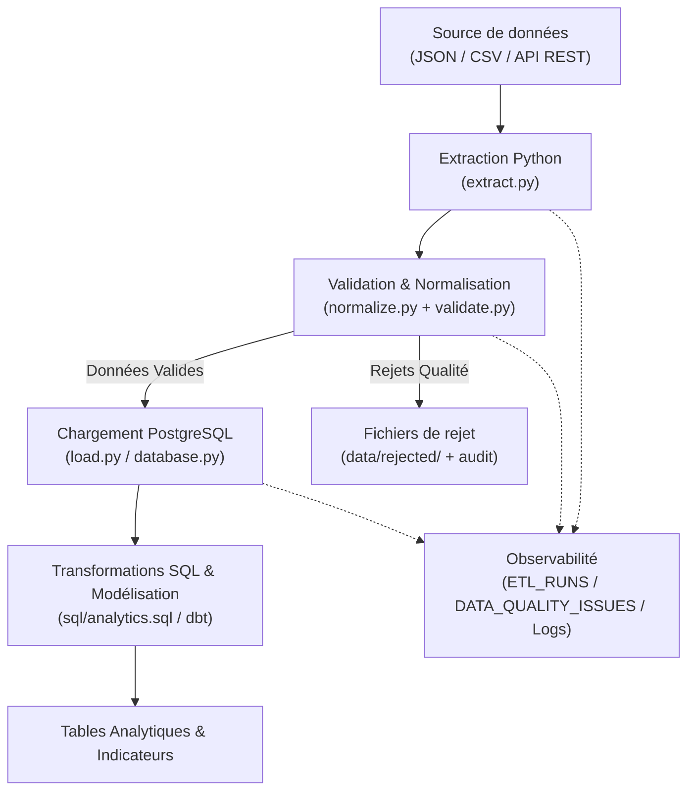

# Plan d'Implémentation Technique — Vehicle Fleet Data Pipeline

Ce document détaille la stratégie d'implémentation progressive, l'architecture logicielle, les contrats de données, la gestion des erreurs et la feuille de route du projet **Vehicle Fleet Data Pipeline**.

---

## 1. Contexte & Principes Directeurs

- **Objectif** : Construire un pipeline de données de bout en bout collectant, normalisant, validant et ingérant des données de télémétrie de véhicules dans PostgreSQL, puis produisant des tables analytiques fiables.
- **Environnement Python cible** : Python `>=3.11` (compatible 3.11 / 3.12, conteneurs Docker basés sur `python:3.12-slim`).
- **Configuration** : Gestion centralisée, typée et validée via `pydantic-settings` et variables d'environnement (`.env`).
- **Séparation stricte des erreurs** :
  - **Rejets de données (non fatals)** : Lignes individuelles invalides (coordonnées hors bornes, champ obligatoire manquant, date mal formée). Ces lignes sont isolées dans `data/rejected/` et répertoriées dans `data_quality_issues` sans interrompre le traitement des données valides.
  - **Erreurs fatales d'exécution** : Fichier source manquant ou illisible (syntaxe JSON corrompue), panne de connectivité PostgreSQL, permissions insuffisantes. Le pipeline s'interrompt avec journalisation, statut `FAILED` dans `etl_runs` et code de sortie non nul (`sys.exit(1)`).

---

## 2. Architecture Globale

---

## 3. Modèle Relationnel & Ordre de Dépendance (DDL)

Pour respecter scrupuleusement l'intégrité référentielle et les contraintes de clés étrangères (`FOREIGN KEY`), la création des tables et le chargement s'effectuent dans l'ordre strict suivant :

1. **`etl_runs`** (aucune dépendance) :
   - `etl_run_id` (BIGSERIAL PK)
   - `started_at` (TIMESTAMPTZ NOT NULL)
   - `finished_at` (TIMESTAMPTZ)
   - `status` (VARCHAR NOT NULL : 'RUNNING', 'SUCCESS', 'FAILED')
   - `rows_read` (INTEGER DEFAULT 0)
   - `rows_loaded` (INTEGER DEFAULT 0)
   - `rows_rejected` (INTEGER DEFAULT 0)
   - `error_message` (TEXT)

2. **`vehicles`** (aucune dépendance) :
   - `vehicle_id` (BIGSERIAL PK)
   - `source_vehicle_id` (VARCHAR UNIQUE NOT NULL)
   - `vehicle_name` (VARCHAR)
   - `vehicle_type` (VARCHAR)
   - `created_at` (TIMESTAMPTZ DEFAULT NOW())
   - `updated_at` (TIMESTAMPTZ DEFAULT NOW())

3. **`vehicle_positions`** (dépend de `vehicles` et `etl_runs`) :
   - `position_id` (BIGSERIAL PK)
   - `source_record_id` (VARCHAR UNIQUE NOT NULL)
   - `vehicle_id` (BIGINT NOT NULL REFERENCES vehicles(vehicle_id) ON DELETE CASCADE)
   - `latitude` (NUMERIC(9,6) NOT NULL)
   - `longitude` (NUMERIC(9,6) NOT NULL)
   - `observed_at` (TIMESTAMPTZ NOT NULL)
   - `ingested_at` (TIMESTAMPTZ DEFAULT NOW())
   - `source_name` (VARCHAR NOT NULL)
   - `etl_run_id` (BIGINT NOT NULL REFERENCES etl_runs(etl_run_id) ON DELETE CASCADE)

4. **`data_quality_issues`** (dépend de `etl_runs`) :
   - `issue_id` (BIGSERIAL PK)
   - `etl_run_id` (BIGINT NOT NULL REFERENCES etl_runs(etl_run_id) ON DELETE CASCADE)
   - `source_record_id` (VARCHAR)
   - `issue_code` (VARCHAR NOT NULL)
   - `issue_message` (TEXT NOT NULL)
   - `detected_at` (TIMESTAMPTZ DEFAULT NOW())

---

## 4. Stratégie d'Idempotence & Clés Métier

Pour garantir qu'une réexécution du pipeline n'insère aucun doublon :

1. **Table `vehicles`** :
   - Clé naturelle unique : `source_vehicle_id`.
   - Mécanisme : `INSERT ... ON CONFLICT (source_vehicle_id) DO UPDATE SET vehicle_name = EXCLUDED.vehicle_name, vehicle_type = EXCLUDED.vehicle_type, updated_at = NOW()`.

2. **Table `vehicle_positions`** :
   - Clé d'unicité : `source_record_id`.
   - Si la source fournit un identifiant stable et unique : utilisation directe de cet identifiant.
   - Si la source ne fournit aucun identifiant de position stable : génération d'une clé de substitution déterministe :
     $$\text{source\_record\_id} = \text{SHA256}(\text{source\_vehicle\_id} \mathbin{\Vert} \text{observed\_at\_utc} \mathbin{\Vert} \text{latitude} \mathbin{\Vert} \text{longitude})$$
   - Mécanisme : `INSERT ... ON CONFLICT (source_record_id) DO NOTHING`.

### Limites documentées de la clé de substitution :
- **Précision temporelle** : Si l'horodatage source a une précision limitée (ex: arrondie à la minute) et qu'un véhicule émet plusieurs relevés distincts durant cette même minute avec des coordonnées quasi-statiques, ils risquent d'être considérés à tort comme des doublons et ignorés.
- **Bruit de capteur** : Si le GPS flotte légèrement ($0.000001^\circ$) lors d'une transmission répétée de la même position, le hash différera et la position sera insérée deux fois.
- **Rejeu de positions identiques à des dates différentes** : Protégé par l'inclusion stricte de l'horodatage UTC complet dans le hash.

---

## 5. Feuille de Route d'Implémentation par Phases

### Phase 1 : Socle Python (MVP Extraction, Normalisation, Validation & Rejets)
*Périmètre immédiat à réaliser :*
- Initialisation Git et configuration d'environnement virtuel.
- Fichiers de configuration : `pyproject.toml`, `.gitignore`, `.env.example`.
- Paramétrage avec `pydantic-settings` (`src/fleet_pipeline/config.py`).
- Configuration centralisée des logs (`src/fleet_pipeline/logging_config.py`).
- Données d'exemple (`data/sample/vehicles.json` et `data/sample/vehicles.csv`) contenant cas valides et cas d'erreur représentatifs.
- Modules métier :
  - `extract.py` : lecture sécurisée JSON / CSV.
  - `normalize.py` : alignement des champs, conversion des dates en UTC.
  - `validate.py` : validation de schéma Pydantic, détection d'anomalies, séparation données valides / rejets.
  - Répertoire de rejet : `data/rejected/`.
- Tests unitaires complets (`pytest`) couvrant extraction, normalisation, validation et rejets.

### Phase 2 : PostgreSQL, Chargement Transactionnel & Idempotence
*(En attente de validation de la Phase 1)*
- Scripts DDL dans le bon ordre de dépendance (`sql/schema.sql`).
- Connexion SQLAlchemy et gestion de transactions (`database.py`, `load.py`).
- Implémentation du chargement idempotent (UPSERT / ON CONFLICT).
- Enregistrement des exécutions dans `etl_runs` et des anomalies dans `data_quality_issues`.
- Requêtes analytiques SQL (`sql/analytics.sql`).
- Tests d'intégration (`tests/integration/test_load.py`).

### Phase 3 : Industrialisation, Conteneurisation & Reproductibilité
- Point d'entrée en ligne de commande (`src/fleet_pipeline/cli.py`).
- Conteneurisation Docker & Docker Compose (`Dockerfile`, `compose.yaml`, `docker/postgres/init.sql`).
- CI GitHub Actions (`.github/workflows/tests.yml`).
- Documentation complète (`README.md`, `docs/architecture.md`, `docs/data-model.md`, `docs/decisions.md`).

### Phase 4 : Modélisation dbt Core & Extensions
- Projet dbt Core, modèles `staging` et `marts`.
- Tests de qualité dbt.

---

## 6. Dépendances Minimales Retenues

- `pydantic>=2.7` & `pydantic-settings>=2.2` : Contrat de données, typage strict et gestion des configurations par variables d'environnement.
- `pandas>=2.2` : Manipulation tabulaire et normalisation.
- `sqlalchemy>=2.0` & `psycopg[binary]>=3.1` : Connecteur et transactions PostgreSQL.
- `python-dotenv>=1.0` : Chargement du fichier `.env`.
- `requests>=2.31` : Consommation d'API HTTP.
- `pytest>=8.0` & `pytest-cov>=5.0` : Framework de test.
- `ruff>=0.4` : Linting et formatage rapide.

